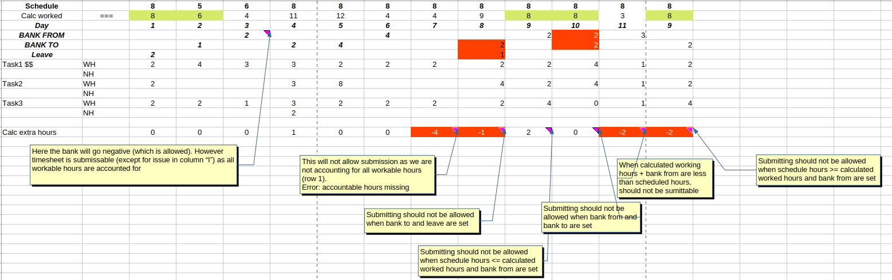

# BankOfHours

Bank of Hours transactions are recorded on the <glossary:DayEntry> model in its signed `bank` field. A positive value adds hours to the bank; a negative value uses hours from the bank. The resulting balance can be negative.

## When hours can be added to bank?
<glossary:Resource> can add hours to bank when number of hours worked for selected day > working_schedule for that day.

You cannot add hours to bank when there is logged holiday, sick day, leave etc. for that day.

## When hours can get hours from bank?
<glossary:Resource> can get hours from bank when number of hours worked for selected day < working_schedule for that day.

You cannot get hours from bank when there are overtime hours for that day.

For examples when <glossary:Resource> can or cannot deposit/withdraw hours check that table:
{ style="width:100%; display:block; margin:auto;" }

## Balance limits

The balance must stay between the configured lower and upper bounds (by default -16.0 and 16.0 hours, see the Constance settings `BANK_HOURS_LOWER_BOUND` and `BANK_HOURS_UPPER_BOUND`).

The limit applies to the whole running balance, day by day: changing a transaction also re-checks every following day, so a retroactive entry cannot silently push a later day out of range.

Only movements of the balance are checked. Logging ordinary hours (zero bank) is always allowed, even when the balance is already outside the limits.

The balance up to a given day starts from the `bank_hours` value frozen in the most recent closed timesheet ending on or before that day, then adds the later bank movements. The frozen value is authoritative even when earlier timesheets are open or missing. When no closed timesheet containing `bank_hours` is available, the balance is calculated from all existing DayEntry records.
