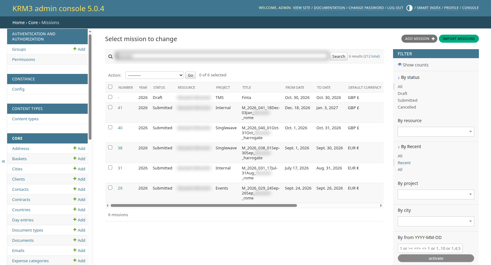
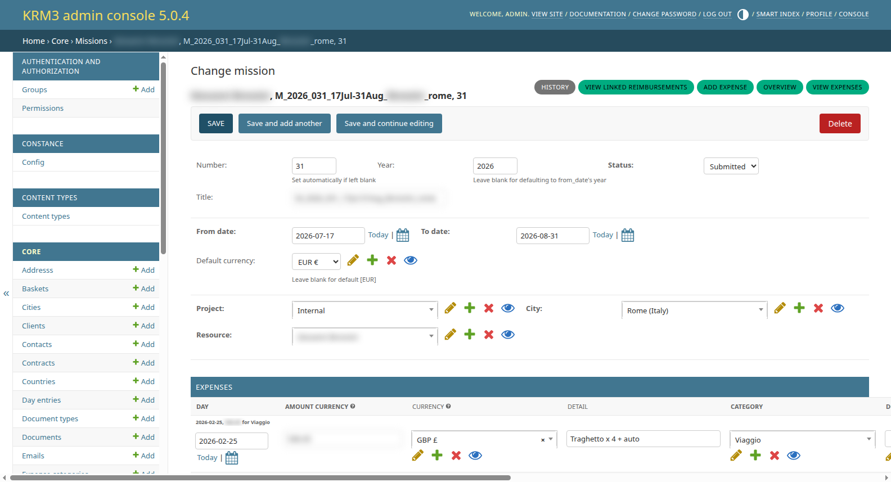
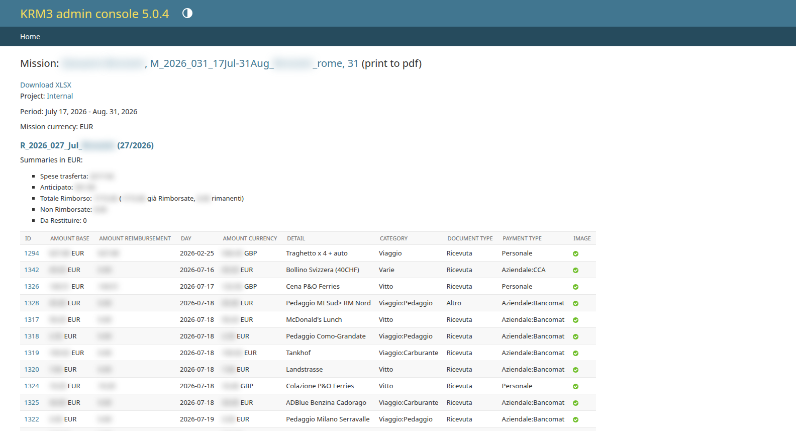
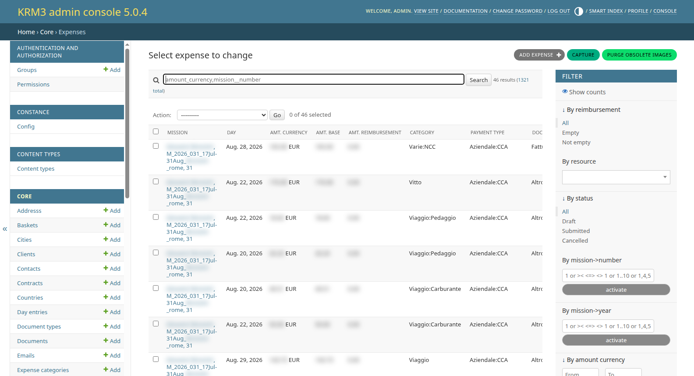
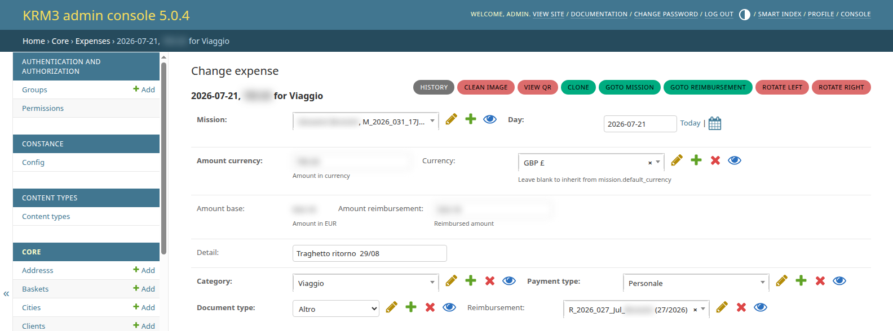
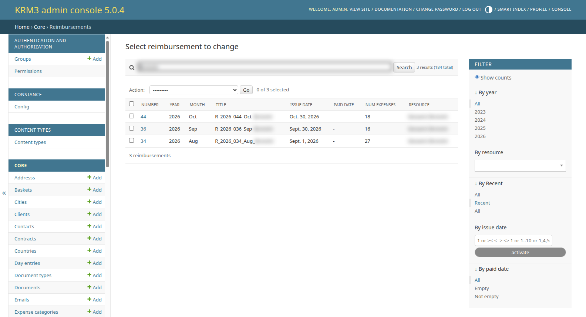
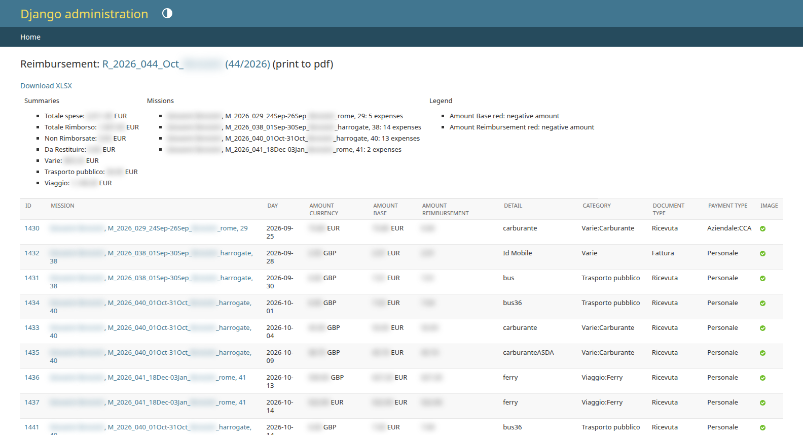

# Missions - Admin console

This page is for **mission managers**: the people who check the missions of everybody,
fix their expenses and pay them back. Employees record their own missions and expenses
from the application, as described in [Missions](index.md).

Managers work in the **admin console** (`/admin/`, *Core* section), which has three main
pages:

| Page               | What you do there                                                                  |
|--------------------|------------------------------------------------------------------------------------|
| *Missions*         | Check, correct, submit and cancel missions of any person; mission overview         |
| *Expenses*         | Check receipts and amounts, convert currencies, create reimbursements              |
| *Reimbursements*   | Check reimbursements, record their payment, print the reports                      |

What you can do depends on your permissions:

| Permission                 | In the admin console                                                       |
|----------------------------|----------------------------------------------------------------------------|
| `core.view_any_mission`    | See every mission and reimbursement, without changing them                 |
| `core.manage_any_mission`  | See and change every mission and reimbursement: the *mission manager*      |
| `core.manage_any_expense`  | See and change every expense                                               |
| `core.add_reimbursement`   | Create reimbursements                                                      |

!!! tip "Recent records only"
    The *Missions* and *Reimbursements* lists show only recent records by default (filter
    *By Recent*). Choose *All* in that filter to search older ones.

## The monthly routine

1. **Check the submitted missions.** In *Missions*, filter *By status: Submitted*; the *To
   Reimburse* column counts the expenses not reimbursed yet. Open the
   [Overview](#mission-overview) of each mission to check its expenses and totals.
2. **Fix what is wrong.** Missing or rotated receipts, wrong payment types, amounts to
   override: see [Expenses](#expenses).
3. **Select the expenses to pay.** In *Expenses*, filter *By reimbursement: Empty* and
   *By status: Submitted*.
4. **Create the reimbursements** with the *Create reimbursement* action, one per person.
   See [Create the reimbursements](#create-the-reimbursements).
5. **Print the report** with the *Reimbursement report* action and pay.
6. **Record the payment** by setting the *Paid date* of each reimbursement.

## Missions

{ style="width:90%; display:block; margin:auto;" }

The list shows number, year, status, person, project, title, dates, currency, city, the
number of expenses and how many are still to reimburse. Search by person, title, project
or city; filter by status, project, city, dates, number or year.

### Create and change a mission

*Add mission* creates a mission for any person. The mission page shows its expenses at
the bottom, where you can also add or change them.

{ style="width:90%; display:block; margin:auto;" }

Unlike the application, the admin form lets you change the **status** freely, within the
rules of the <glossary:Mission> lifecycle:

| To...                                   | Do this                                                                 | Not allowed when                    |
|-----------------------------------------|-------------------------------------------------------------------------|-------------------------------------|
| Submit a Draft mission                  | Click **Submit**, or set *Status* to Submitted and save                 | -                                   |
| Cancel a mission                        | Set *Status* to Cancelled and save. The number is kept                  | An expense is already reimbursed    |
| Reopen a cancelled mission              | Set *Status* to Submitted and save                                      | -                                   |
| Bring a mission back to Draft           | Set *Status* to Draft, **clear the Number** and save                    | An expense is already reimbursed    |

The number is assigned automatically on submission: leave it empty. Errors are shown at
the top of the page and nothing is saved.

### Buttons of the mission page

| Button                          | What it does                                                                                  |
|---------------------------------|-----------------------------------------------------------------------------------------------|
| **Submit**                      | Submits a Draft mission and assigns its number                                                |
| **Add expense**                 | Opens a new expense for the mission, dated on its first day                                   |
| **View expenses**               | Opens the *Expenses* list filtered on the mission                                             |
| **Overview**                    | Opens the [mission overview](#mission-overview)                                               |
| **View linked reimbursements**  | Lists the reimbursements that include expenses of the mission                                 |

### Mission overview

The overview groups the expenses of the mission by reimbursement (expenses not reimbursed
yet come last) and shows a summary for each group, in euro:

{ style="width:90%; display:block; margin:auto;" }

| Summary line         | Meaning                                                                                  |
|----------------------|------------------------------------------------------------------------------------------|
| *Spese trasferta*    | Cost of the mission: company-paid expenses plus what is refunded for personal ones       |
| *Anticipato*         | Paid with Company means (e.g. company card)                                              |
| *Totale Rimborso*    | Sum of the reimbursement amounts, split between already reimbursed and still to pay      |
| *Non Rimborsate*     | Personal expenses that are not refunded (e.g. no receipt)                                |
| *Da Restituire*      | Company-paid expenses without justification, that the person must give back              |

Opening the overview also converts to euro the expenses not reimbursed yet that still
lack the converted amount. *print to pdf* prints the page, *Download XLSX* exports the
expenses.

### Export and import

- The **Export selected missions** action downloads the selected missions, with their
  expenses and receipts, as a ZIP archive.
- The **Import missions** button (managers only) uploads such an archive and shows its
  content for checking.

## Expenses

{ style="width:90%; display:block; margin:auto;" }

The list shows, for each expense, its mission, day, amounts, category, payment type,
document type, reimbursement and a link to the receipt. Colours help spot problems:

- the mission is **grey** when Draft and ~~struck through~~ when Cancelled;
- the amount in currency is **blue** for personal expenses;
- amounts are **red** when negative (money the person owes the Company).

Useful filters: *By reimbursement* (*Empty* = not reimbursed yet), *By status* (of the
mission), *By resource*, mission number and year, amount, category, document type and day.

### Change an expense

{ style="width:90%; display:block; margin:auto;" }

Besides the fields the employee fills in, a manager can:

- **override the reimbursement amount** (*Amount reimbursement*), for example to refund
  only part of an expense. The automatic calculation only fills an empty amount, so the
  value you set is kept (see [Reimbursement amount](../../../glossary/terms/Expense.md#reimbursement-amount));
- move the expense to another mission or link it to a reimbursement.

Once an expense belongs to a reimbursement its amount is frozen: its receipt and payment
type cannot be changed any more.

### Buttons of the expense page

| Button                     | What it does                                                                                       |
|----------------------------|----------------------------------------------------------------------------------------------------|
| **View QR**                | Shows a QR code the person can scan with a phone to upload the receipt (see [the user guide](index.md#upload-the-receipt-from-your-phone)) |
| **Clone**                  | Opens a new expense with the same mission, day, category, payment type, document type and currency |
| **Goto mission**           | Opens the mission of the expense                                                                   |
| **Goto reimbursement**     | Opens the reimbursement of the expense, if any                                                     |
| **Rotate left / right**    | Rotates the receipt image. A copy is kept and the message offers a link to revert                  |

On the *Expenses* list:

- **Capture**, available when the list is filtered on a mission (*View expenses* button
  of the mission), shows the QR codes of the mission's expenses without receipt one after
  the other, so the receipts can be uploaded from a phone in one go;
- **Purge obsolete images** deletes the stored image files that no expense refers to any
  more. It cannot be undone.

### Actions on the selected expenses

Select the expenses in the list, choose the action and click **Go**:

| Action                            | What it does                                                                                                   |
|-----------------------------------|----------------------------------------------------------------------------------------------------------------|
| *Get the rates for the dates*     | Converts to euro, with the rate of each expense day, the expenses that lack the converted amount. Submitted missions only |
| *Recalculate reimbursement*       | Recomputes the reimbursement amount of the expenses not reimbursed yet, **overwriting** any override          |
| *Reset reimbursement*             | Empties the reimbursement amount of the expenses not reimbursed yet, so it is computed again later             |
| *Create reimbursement*            | Creates the reimbursements, see below                                                                         |

### Create the reimbursements

1. Select the expenses to pay: all of them must belong to **Submitted** missions and not
   be reimbursed yet, otherwise the action stops with a warning.
2. Run *Create reimbursement*. The preview groups the expenses by person and mission;
   missing conversions are done first.
3. Choose the **year** (one of the years of the selected missions) and the **month**,
   and confirm.
4. One reimbursement per person is created and numbered, and each expense gets its
   reimbursement amount if it was still empty.

This is the only way to create reimbursements: the *Reimbursements* page has no *Add*
button. See <glossary:Reimbursement> for the details.

## Reimbursements

{ style="width:90%; display:block; margin:auto;" }

The list shows number, year, month, title, issue date, paid date, number of expenses and
person. Filter *By paid date: Empty* to see the reimbursements still to pay.

- Open a reimbursement to set its **Paid date** once it has been paid, or to check its
  expenses.
- **Overview** shows the expenses of the reimbursement with totals by payment type and by
  expense category; *print to pdf* and *Download XLSX* as for the mission overview.
- **View linked missions** lists the missions its expenses belong to.

{ style="width:90%; display:block; margin:auto;" }

### Reimbursement report

Select one or more reimbursements and run the *Reimbursement report* action: it
summarises them by month, person and mission. How to read the markers next to the mission
numbers (`*`, `^`) is explained in
[the reimbursement process](../../../missions/index.md#reimbursement-report).

## Lookup tables

Three tables in the *Core* section configure the expense form. Change them with care:
existing expenses refer to them.

| Table                  | Contents                                                                                                                       |
|------------------------|--------------------------------------------------------------------------------------------------------------------------------|
| *Payment categories*   | How expenses are paid (<glossary:PaymentType>). The **Personal expense** flag decides whether an expense is refunded or charged back |
| *Expense categories*   | What the money was spent on (<glossary:ExpenseCategory>), as a tree                                                            |
| *Document types*       | The documents justifying the expenses (<glossary:DocumentType>); one can be the default                                        |

Untick *Active* on a document type to stop offering it in the expense form without
deleting it. Payment and expense categories also have an *Active* flag, but the
application still offers inactive ones.
