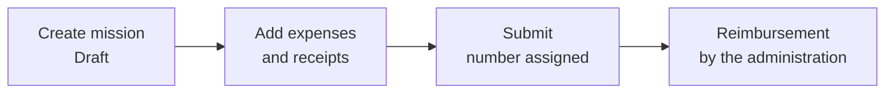
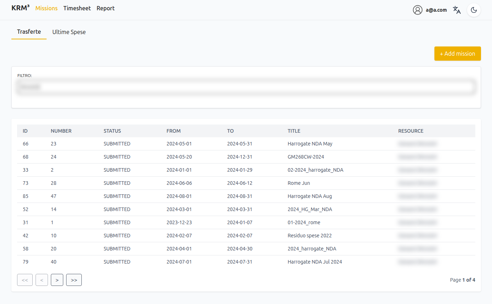
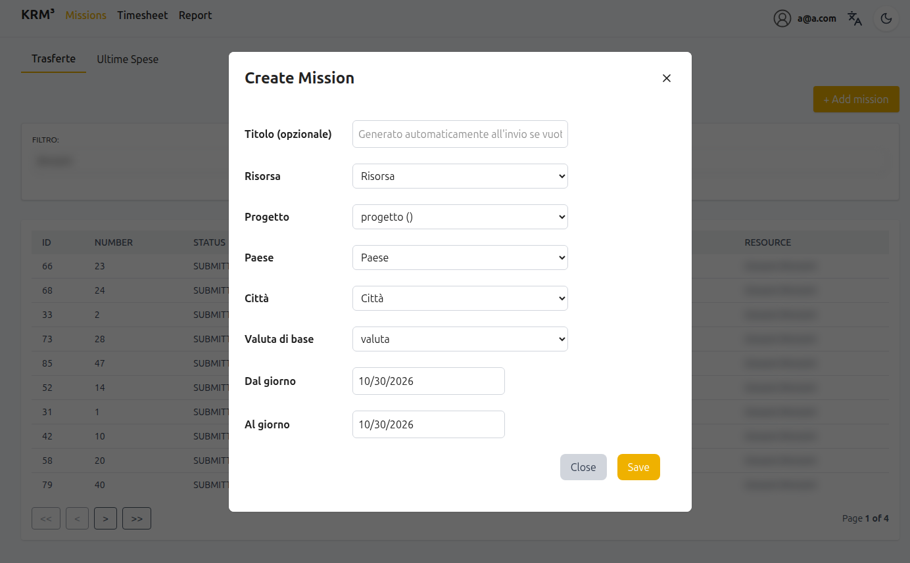
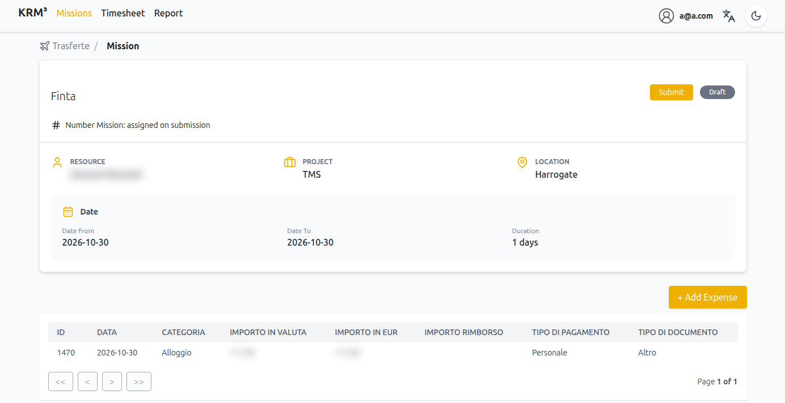
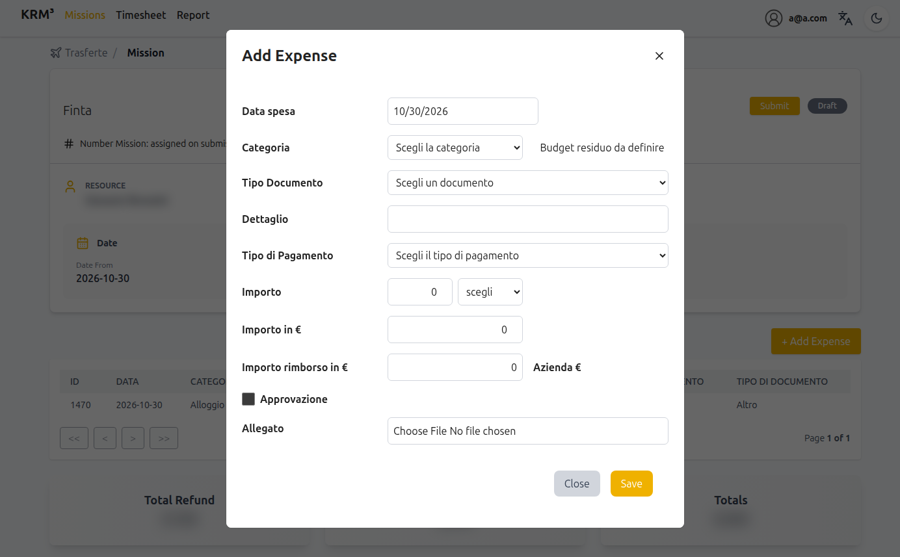
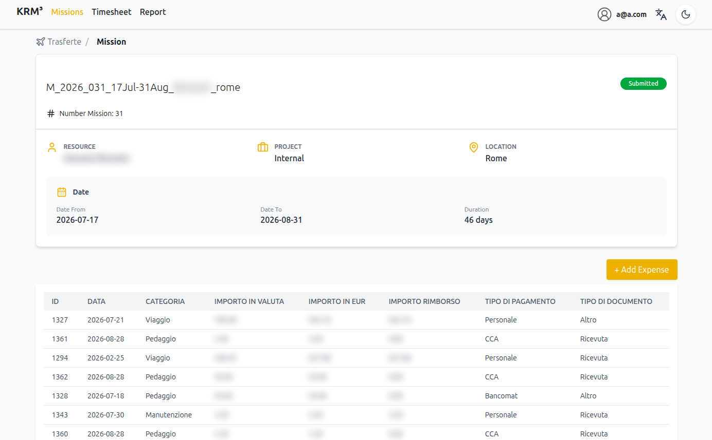

# Missions

A <glossary:Mission> (in Italian *trasferta*) collects the <glossary:Expense>s you incur
during a work assignment or trip. The Company uses them to work out what it owes you, or
what you owe the Company, and pays it back with a <glossary:Reimbursement>.

The module is reached from the **Missions** entry of the top menu. If you do not see it,
the missions module is not enabled for you: ask an administrator.

## The process at a glance

1. **Create the mission** before or during the trip. It starts as **Draft**.
2. **Record each expense** with its receipt, as you go.
3. **Submit the mission** when the trip is over and all expenses are recorded. The
   mission gets its number.
4. An administrator periodically **reimburses** the expenses of submitted missions.

## The Trasferte page

The page has two tabs:

- **Trasferte**: the list of missions you can see, with number, status, dates, title and
  resource. Click a row to open the mission. You can filter the list by date range
  (*Dal* / *Al*, then *Filter*; *Reset* clears it). Administrators filter by resource name
  instead.
- **Ultime Spese**: the latest expenses recorded, across all your missions. Click a row to
  open the expense.

You see your own missions only, unless you have been granted access to other people's
missions.

{ style="width:80%; display:block; margin:auto;" }

## Create a mission

Click **+ Add mission** (top right of the *Trasferte* tab; the button is not shown on
small screens) and fill in the *Create Mission* form:

{ style="width:80%; display:block; margin:auto;" }

| Field                  | What to enter                                                                                       |
|------------------------|-----------------------------------------------------------------------------------------------------|
| *Titolo (opzionale)*   | Leave it empty: a title is generated when the mission is submitted (e.g. `M_2026_003_02Jan-05Jan_Rossi_milano`) |
| *Risorsa*              | Your name, filled in for you. Only mission managers can choose another person                       |
| *Progetto*             | The project the trip is for                                                                         |
| *Paese*, then the city | Where the mission takes place. Choose the country first: the city list shows its cities only        |
| *Valuta di base*       | The currency you will mostly spend in. New expenses use it when you do not choose another one       |
| *Dal giorno*, *Al giorno* | First and last day of the mission. The last day cannot be before the first                       |

Click **Save**. The mission is created as **Draft**, without a number: the list shows `-`
in the *Number* column.

!!! note
    To create missions you need the permission to add missions. If the **+ Add mission**
    button is missing, ask an administrator.

## Record expenses

Open the mission and click **+ Add Expense**. Click an existing row to change it.

{ style="width:80%; display:block; margin:auto;" }

Each expense has:

| Field                 | What to enter                                                                                     |
|-----------------------|---------------------------------------------------------------------------------------------------|
| *Data spesa*          | The day of the expense. It cannot be in the future                                                |
| *Categoria*           | What the money was spent on (e.g. lodging, fuel, flights): the <glossary:ExpenseCategory>        |
| *Tipo Documento*      | The kind of document justifying it (invoice, receipt, ...)                                         |
| *Dettaglio*           | A short description (optional)                                                                    |
| *Tipo di Pagamento*   | How you paid: with your own money or with Company means such as a company credit card. See <glossary:PaymentType> |
| *Importo* and currency | The amount as shown on the receipt, in the currency you paid in                                  |
| *Allegato*            | A photo or scan of the receipt                                                                    |

{ style="width:80%; display:block; margin:auto;" }

Leave the reimbursement amount empty: it is calculated by the system (see
[How much you get back](#how-much-you-get-back)) and, when needed, adjusted by a mission
manager.

The amount is converted to euro with the exchange rate of the expense day when you save.
The converted amount shown in the form while you type is only an estimate; the mission
table shows the saved value in the *Importo in EUR* column.

!!! tip "Attach the receipt"
    Always attach the receipt. Without it, an expense paid with your own money is **not**
    refunded, and an expense paid with a company card is charged back to you.

### Upload the receipt from your phone

An administrator can show the QR code of an expense (*View QR* in the administration
pages). Scanning it with your phone opens an upload page where you can pick a file or take
a photo of the receipt, without logging in. The code works once: it stops working as soon
as the expense changes, for example after the upload.

## Submit the mission

When the trip is over and all the expenses are recorded, open the mission and click
**Submit** (next to the *Draft* badge). The button is shown to the person the mission
belongs to and to mission managers.

On submission:

- the status becomes **Submitted**;
- the mission gets its **number**, per year and starting again from 1 every year;
- the title is generated, if you left it empty.

{ style="width:80%; display:block; margin:auto;" }

You cannot cancel a mission or bring it back to Draft yourself: ask an administrator.

Only expenses of **submitted** missions are reimbursed, so do not forget this step.

## How much you get back

Each expense has a reimbursement amount, in euro, that depends on how you paid and on
whether the receipt is attached:

| You paid with                     | Receipt attached | Reimbursement amount | Meaning                                       |
|-----------------------------------|------------------|----------------------|-----------------------------------------------|
| Your own money                    | yes              | + amount             | The Company refunds you                       |
| Your own money                    | no               | 0                    | Not refunded until you attach the receipt     |
| Company means (e.g. company card) | yes              | 0                    | Justified spending, nothing owed              |
| Company means (e.g. company card) | no               | - amount             | Unjustified spending, you must give it back   |

The amount is calculated when the expense is included in a reimbursement, or earlier when
you attach a receipt or change the payment type. A mission manager can override it in the
administration pages, for instance to refund only part of an expense; the value they set
is kept. The detailed rules are in
[Reimbursement amount](../../../glossary/terms/Expense.md#reimbursement-amount).

## Reimbursement

Periodically the administration gathers the expenses of submitted missions that have not
been reimbursed yet into a <glossary:Reimbursement>, one per person, possibly covering
several missions. The total is what the Company pays you (positive) or what you owe the
Company (negative).

Once an expense is part of a reimbursement its amount is frozen: you can no longer attach
a receipt or change its payment type.

Expenses recorded later, such as a receipt found after the trip, are not lost: they are
included in a following reimbursement.

## Who can see and change what

| You are                                   | Your own missions and expenses | Other people's missions and expenses |
|-------------------------------------------|--------------------------------|--------------------------------------|
| Employee                                  | view, change, delete           | no access                            |
| With *view any* permission                | view, change, delete           | view only                            |
| Mission / expense manager                 | view, change, delete           | view, change, delete                 |

For the full rules see the glossary pages <glossary:Mission>, <glossary:Expense> and
<glossary:Reimbursement>, and [the reimbursement process](../../../missions/index.md).
Mission managers will find their operations in
[Missions - Admin console](admin.md).
