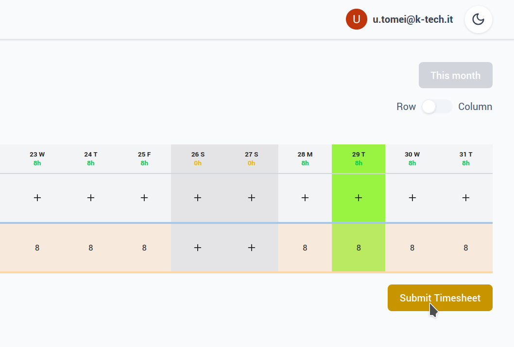

# How to submit a timesheet

When your full-month timesheet is complete, submit it by clicking the **Submit Timesheet** button. After submission, you cannot amend its entries until the timesheet is reopened. Check your entries before submitting.

{ style="width:60%; display:block; margin:auto;" }

## When you can submit a timesheet

You can submit a timesheet when all Due Hours under an active Contract are covered. Each day with Due Hours must have a DayEntry, and the recorded work, holiday, sickness, leave, special leave, rest or Bank of Hours data must cover those hours.

A TaskEntry is needed only to record worked hours. A day fully covered by holiday, sickness or another supported absence can be complete without a TaskEntry. Days outside an active Contract and days with zero Due Hours do not need a DayEntry. If the timesheet period has no active Contract, there are no Due Hours to validate.
