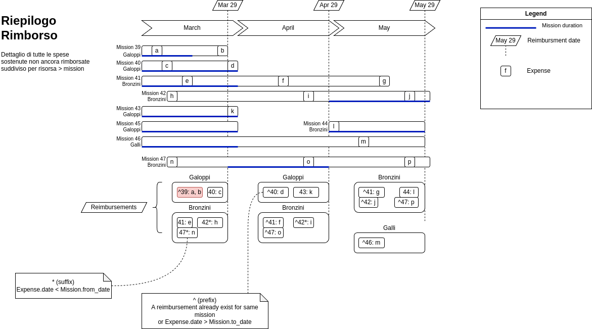

# Missions

A <glossary:Mission> collects the <glossary:Expense>s a <glossary:Resource> incurs during a
work assignment or trip. Periodically, the expenses not yet settled are gathered into
<glossary:Reimbursement>s, which tell how much the Company owes each Resource (or the
Resource owes the Company).

## The process

1. **Create the mission.** The Resource (or an administrator) creates the mission with its
   dates, project, city and, optionally, a title. The mission starts as **Draft**, without a
   number.
2. **Record the expenses.** Each expense records the day, amount and currency, category,
   payment type and document type. The receipt image can be uploaded directly, or from a
   phone by scanning the QR code shown by the expense's QR page in the admin.
3. **Submit the mission.** When the mission is complete it is submitted (mission page,
   admin or API). Submission assigns the mission number for its year. See
   [Lifecycle and numbering](../glossary/terms/Mission.md#lifecycle-and-numbering).
4. **Reimburse.** Periodically an administrator selects the expenses not yet reimbursed
   and creates the reimbursements: one per Resource, possibly spanning several missions.
   The amount of each expense follows the
   [reimbursement amount rules](../glossary/terms/Expense.md#reimbursement-amount); see
   [How reimbursements are created](../glossary/terms/Reimbursement.md#how-reimbursements-are-created).
5. **Pay.** Once the reimbursement is settled its `paid_date` is filled in.

Expenses recorded after a reimbursement (for instance a late receipt, or an expense
outside the mission dates) are not lost: they stay unreimbursed and are included in a
later reimbursement.

## Reimbursement report

The *Reimbursement report* (Reimbursement admin action) summarises the selected
reimbursements by month, Resource and Mission. The diagram below shows three monthly
reimbursements (Mar 29, Apr 29, May 29) for missions that run across those dates: each
reimbursement contains, for each Resource, the expenses not reimbursed before.

In the report each mission is identified by its number, with these markers:

| Marker          | Meaning                                                                                                                                         |
|-----------------|-------------------------------------------------------------------------------------------------------------------------------------------------|
| `*` (suffix)    | The mission has expenses dated **before** its `from_date` in this reimbursement                                                                 |
| `^` (prefix)    | The mission has expenses dated **after** its `to_date` in this reimbursement, or the mission already has expenses in another reimbursement     |

For example `^41` means that some expenses of mission 41 are in another reimbursement
(or fall after the mission end), and `42*` that mission 42 has expenses dated before it
started. In the diagram the expense date is called `Expense.date`; the actual field is
`day`.
